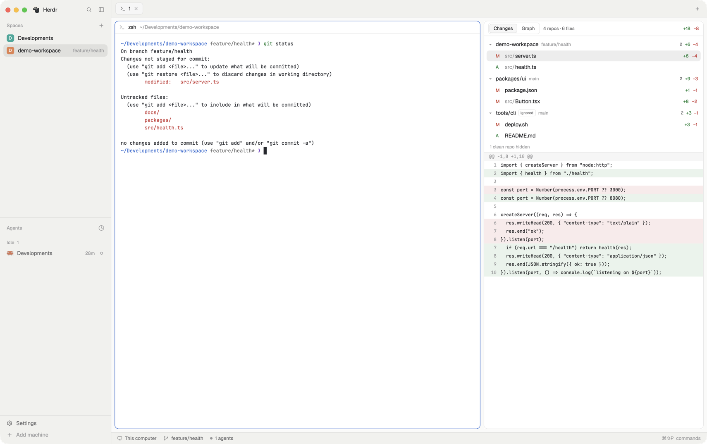
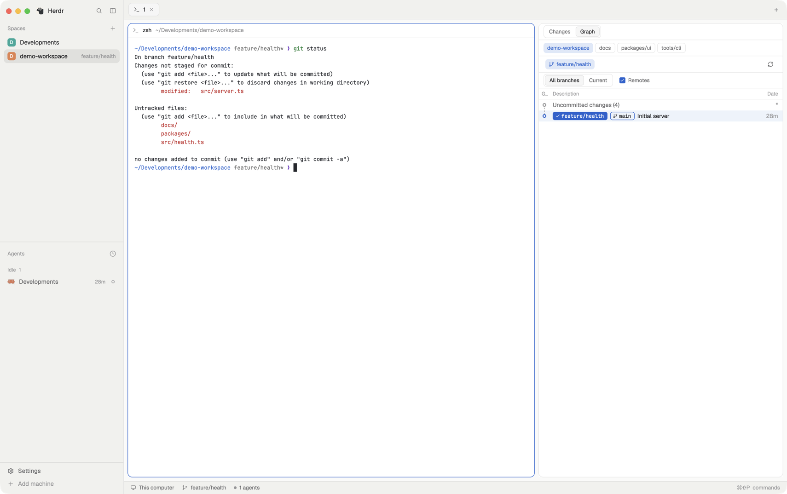

# Main + Nested Diff for Herdr

Herdr's `main` layout plus a git panel on the right that shows uncommitted changes for the repo you're in **and every git repo nested below it**, with a commit graph tab. See [RECIPE.md](RECIPE.md) for the full description.





## Install

```sh
git clone https://github.com/hongmono/herdr-nested-diff.git
cd herdr-nested-diff
cp layouts/main-nested-diff.json ~/.config/herdr-app/layouts/
cp -R mods/nested-diff ~/.config/herdr-app/mods/
```

Then add this key to the `global` section of your `~/.config/herdr-app/keys.json` (don't replace the file):

```json
"cmd-shift-g": "layout.toggle:nested-diff"
```

Switch to it with `ctrl-shift-l` (or `layout.switch main-nested-diff`). If you already have a layout or mod with the same name, rename the new one first.

Or ask your Herdr agent: "add the layout from github.com/hongmono/herdr-nested-diff".

## Requirements

- Herdr 0.1.11 or later
- `git` and `find` on the machine running the space

## Credits

The Graph view is adapted from [rabeeh-ta/herdr-git-graph](https://github.com/rabeeh-ta/herdr-git-graph) (MIT). Icons drawn after [Lucide](https://lucide.dev) (ISC). Licenses are in `mods/nested-diff/`.
