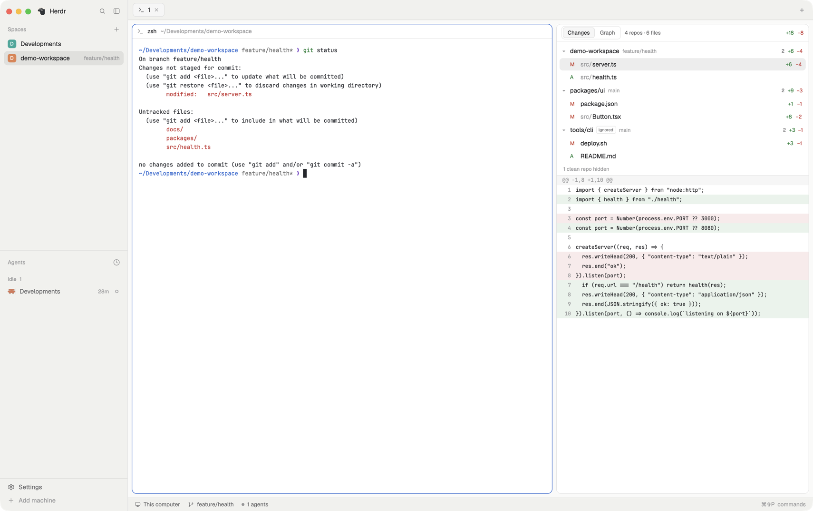

# Main + Nested Diff

Herdr's `main` layout with a 420px git panel docked on the right of the terminals. The panel lists uncommitted changes for the repo you're in **and every git repo nested below it**, including ones the outer repo ignores or doesn't track, so a folder of projects (or a monorepo with vendored repos) reads as one change list. A second tab shows a commit graph with branch actions. `cmd-shift-g` shows or hides the panel.

## What you see

Left to right:

1. **Sidebar** (268px, `chrome` background), the same as `main`: brand bar (46px, `workspace-chrome`), Spaces and Agents lists sharing the height (weight 1 each, min 90px), footer (69px, `workspace-chrome` with `footer: true`).
2. **Work column**: tabs bar (42px, `tabs`), then the work body, then the status bar (28px, `workspace-status`).
   - Work body is a row: the active tab's terminals (`main`), `main`'s Files/Changes panel (368px, hidden by default, as shipped), and the **Nested Diff panel** (420px, min 300, max 900, 1px `border` outline, radius 10).

Nested Diff panel, top to bottom:

- **Header bar** (36px): a `Changes | Graph` segmented switch; on Changes, `N repos · M files`, a spinner while scanning, then the total `+adds` (ansi2 green) and `−dels` (ansi1 red).
- **Change list** (Changes tab; grows with content, 44–300px, scrolls): one group per repo with changes.
  - Group header (28px): ▾/▸ fold arrow, repo path relative to the base (base repo shows its folder name), an `ignored` badge when the parent repo ignores it, the branch in dim text, file count, `+adds`/`−dels`, or `error` in red.
  - File rows (26px, indented 22px): status letter (`A` green, `M` in the theme's `blocked` color, `D`/`U` red), dimmed directory + file name, `+n`/`−n`. The open file is highlighted with `selected`.
  - Below the list, when some repos are clean: `N clean repos hidden`.
- **Diff view** (rest of the height): unified diff of the selected file in the terminal font at 11px, 20px rows, line numbers in a 30px dim column, added lines tinted ansi2 at `18` alpha, removed lines tinted ansi1, hunk headers on `raised`. Scrolls both ways.
- **Graph tab**: when there are 2+ repos, a row of repo chips (selected one in `accent`); below it, a Git Graph style table (graph lanes, description with branch/tag/remote labels, date, author, commit) for the chosen repo, with a fetch button when the repo has remotes.

## How it behaves

- The panel follows the focused terminal's working directory. Clicking inside the panel keeps showing the last terminal you came from in that tab.
- Base: the git repo containing that directory, or the plain folder if it isn't a repo (a folder of repos). It refuses to scan your home folder.
- Nested repos are found with `find` up to 6 levels deep (max 60 repos), skipping `node_modules`, `.venv`, `venv`, `target`, `dist`, `build`, `.next`, `.nuxt`, `.cache`, `vendor`, `Pods`, `.gradle`, `.terraform`, `__pycache__`, `.direnv`. The repo list is re-walked every 60s, or immediately when a `.git` appears or disappears.
- Changes refresh on any file change under the base (folder watch), ignoring churn inside the pruned folders, plus a safety refresh every 60s. Without a folder watch (a space on another machine, or the watch failed) it polls every 10s instead. A change that lands while a refresh is running triggers one more pass right after it.
- When more than 60 nested repos are found, a dim line under the list says `Showing the first 60 nested repos`.
- The first changed file opens automatically. Click a file to open its diff, click it again to close it. Click a group header to fold it.
- Untracked and newly added files show their whole content as additions. Binary files say so. Limits: 1000 files per repo, 1500 diff lines, 4000 characters per line.
- Graph: double-click a label to check out; right-click labels/commits for menus (checkout, merge, rebase, reset, revert, stash, push branch, fetch). Actions open a confirmation dialog when they need input, run git, and show a success or error toast.
- Works for spaces on other machines too: every git call runs on the space's machine.
- `cmd-shift-g` toggles the panel (`layout.toggle:nested-diff`).

## Built from

- Layout `layouts/main-nested-diff.json`: a clone of Herdr's `main` (0.1.11) with one block added at the end of `work-body`: `{ id: "nested-diff", type: "block", content: { mod: "nested-diff" }, size: { px: 420 }, min: 300, max: 900, border: { width: 1, color: "border" }, radius: 10, hidden: false }`.
- Shipped mods it uses: `workspace-chrome`, `spaces`, `agents`, `tabs`, `files`, `changes`, `workspace-status`, `pane`.
- Mod `mods/nested-diff/` (`mod.json`: `{ "place": "right", "size": 420 }`):
  - `main.js`: the panel (Changes view, repo scan, diff).
  - `graph.js`, `lanes.js`, `git.js`, `menu.js`, `dialog.js`, `act.js`: the Graph view, adapted from [rabeeh-ta/herdr-git-graph](https://github.com/rabeeh-ta/herdr-git-graph) (MIT, `LICENSE-git-graph.txt`). `props.role` = `menu` or `dialog` renders the graph's overlays from the same mod.
  - `icons/`: SVGs drawn after Lucide (ISC, `icons/LICENSE-lucide.txt`).
- `herdr` functions: `spaces`, `panes`, `focused`, `props`, `exec`, `readTextFile`, `watchFolder`, `theme`, `settings`, `home`, `notify`, `shared`, `setShared`, `openOverlay`, `run`.
- Programs it runs: `git` (read-only `status`, `diff`, `rev-parse`, `check-ignore`, `log`, plus the graph actions above when you pick them) and `find`. Reads use `--no-optional-locks -c core.fsmonitor=false -c diff.autoRefreshIndex=false` so they write nothing under `.git`. `fetch`/`push` reach your git remotes; nothing else touches the network.
- Keys: `keys.json` adds `"global": { "cmd-shift-g": "layout.toggle:nested-diff" }`.

## Watch out

- Read-only git calls must not write under `.git`, or the folder watch triggers itself in a loop: keep the `READ` flags.
- A child repo appears in its parent's status as `?? sub/` or a submodule entry; filter those out so each repo shows once, in its own group.
- In a repo with no commits yet there is no `HEAD`: diff `--cached` plus the worktree instead of `diff HEAD`.
- Large folders: pruning and the depth/repo caps keep the scan fast; scanning `home()` is blocked.
- Run the per-repo git work a few repos at a time (6), not all at once: 60 repos in parallel open more pipes than the process may (`Too many open files`, os error 24) and some repos show `error`.
- `cmd-shift-g` is a macOS chord; on Windows/Linux pick another key.
- Needs `git` and `find` on the machine running the space.

## Done when

- `herdr-app check` passes for `nested-diff`, and `layout.switch main-nested-diff` shows the panel right of the terminals.
- In a repo with an edited file, the file appears with `M` and correct `+/−`, and clicking it shows the diff.
- In a plain folder holding two repos with changes, both appear as separate groups; a repo the parent ignores shows the `ignored` badge.
- Editing a file updates the list within a few seconds without clicking anything.
- A folder with 62 nested repos lists 60 of them with no `error` groups and shows `Showing the first 60 nested repos`.
- The Graph tab draws the commit history; with 2+ repos, the chips switch between them.
- `cmd-shift-g` hides and shows the panel.
